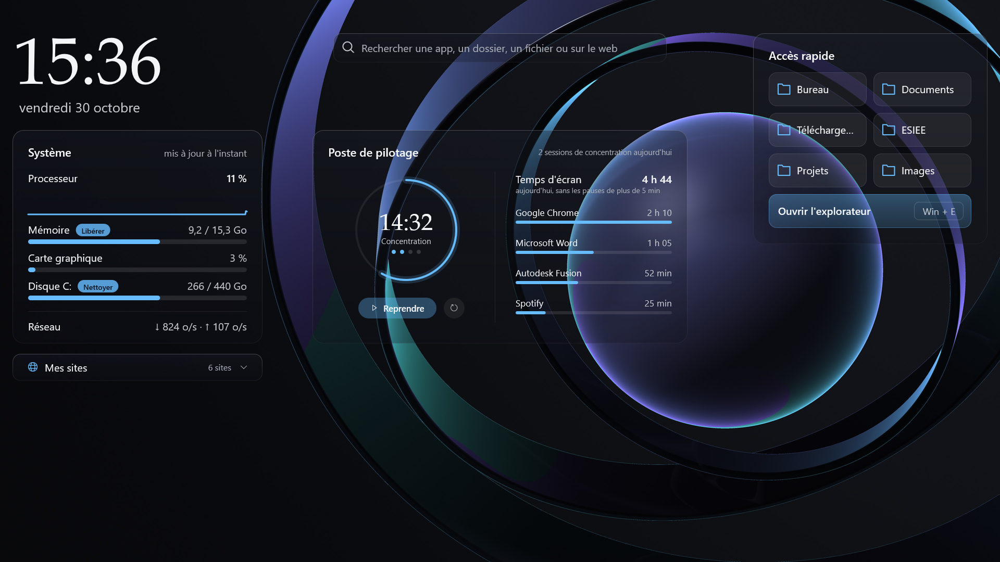
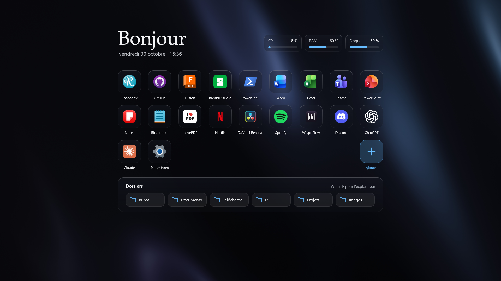
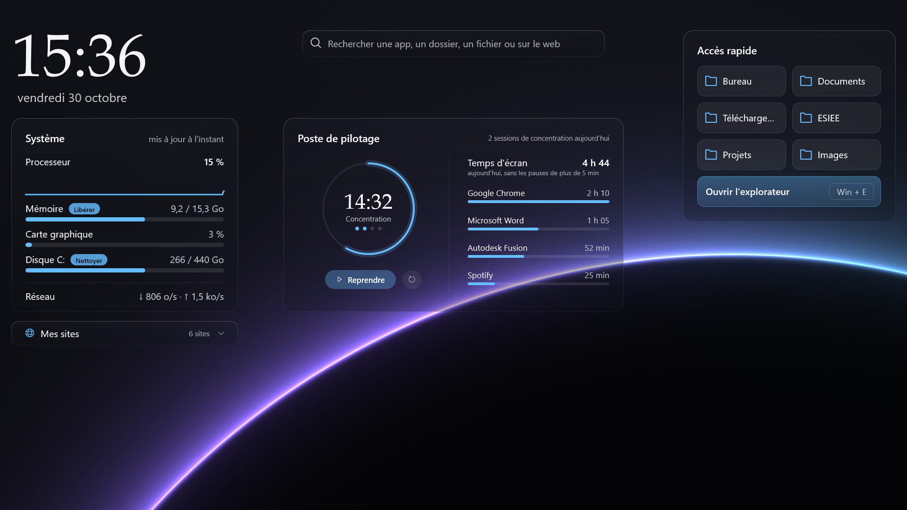
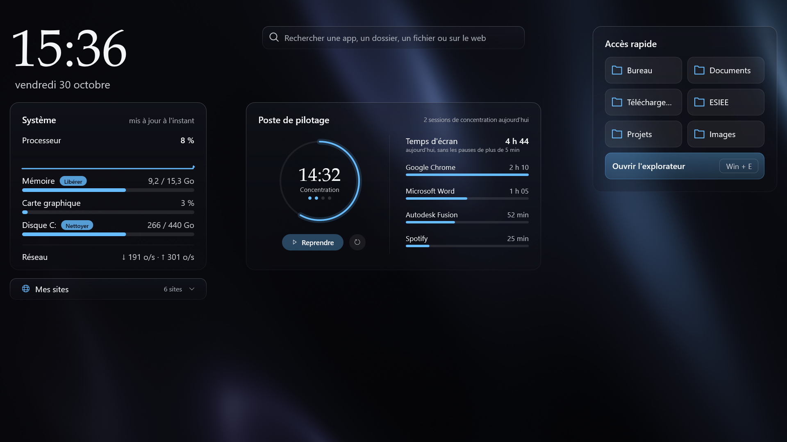
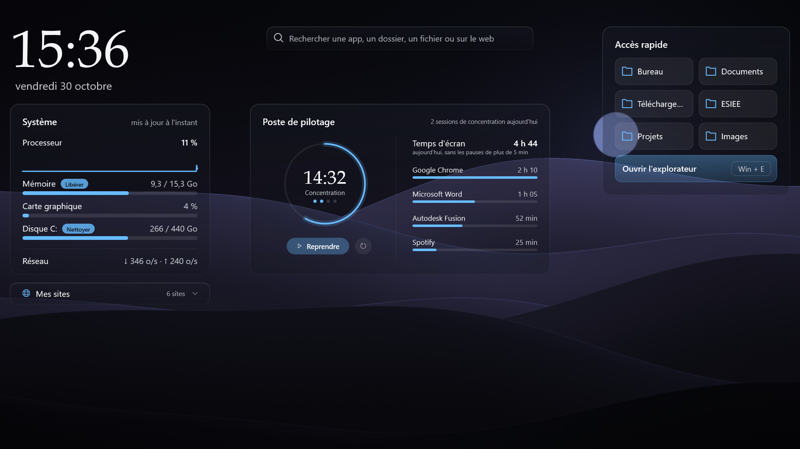
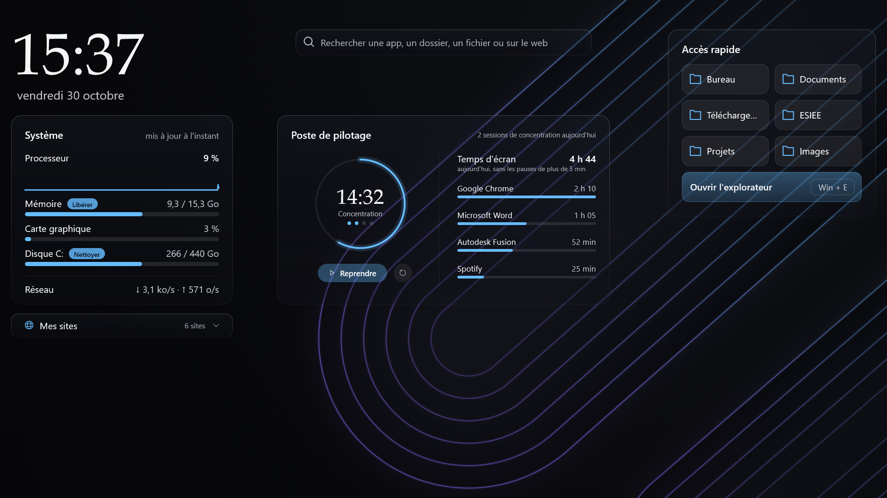
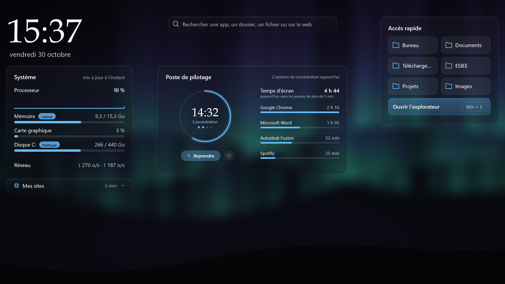
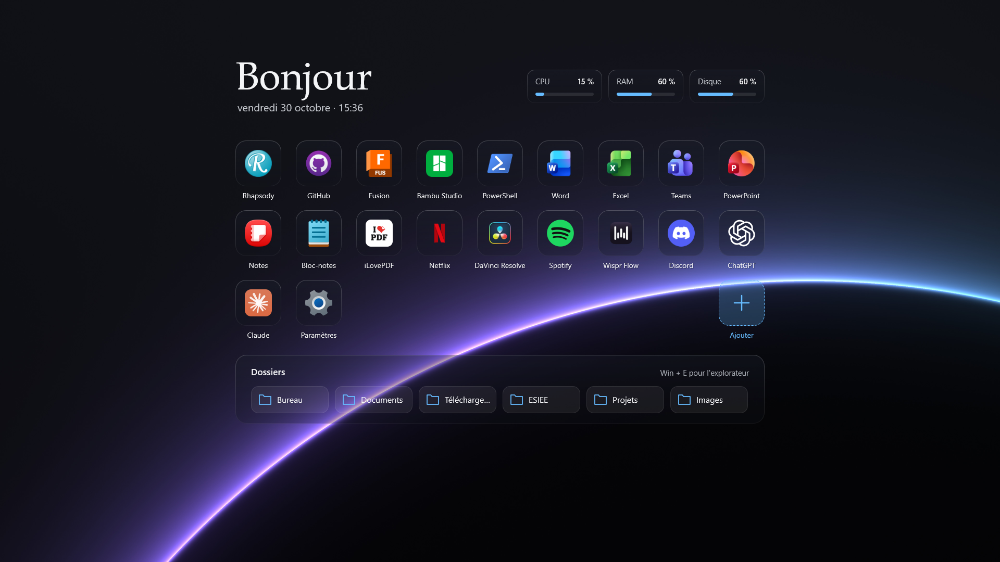

# Verre Desktop

Un mod [Windhawk](https://windhawk.net) pour Windows 11 qui transforme le bureau en tableau de bord en verre : horloge, état du système, recherche, raccourcis, minuteur de concentration, temps d'écran, et un écran d'accueil sur les autres bureaux virtuels.

## Ce que fait le mod

**Bureau 1**
- **Horloge** et date en français.
- **Carte Système** : processeur (avec courbe), mémoire, carte graphique, disque C:, réseau. Boutons **Libérer** (vide la mémoire de travail des apps, sans en fermer aucune) et **Nettoyer** (fichiers temporaires, rapports de plantage, corbeille : analyse puis confirmation).
- **Barre de recherche** : apps installées, dossiers, recherche web (Chrome) et recherche de fichiers.
- **Poste de pilotage** : minuteur de concentration (travail / pause, cycle de 4 sessions) et temps d'écran du jour par app.
- **Accès rapide** : 6 dossiers réglables et l'explorateur.
- **Mes sites** : aperçus de vos sites, ouverts dans Chrome avec le compte de votre choix.

**Autres bureaux virtuels**
- **Écran d'accueil** : salutation, pastilles CPU / RAM / Disque, grille de vos applications, barre Dossiers.

**Fonds d'écran** : 6 fonds « Lumière » faits pour l'interface, au choix ou en diaporama.

## Captures

| | |
|---|---|
|  |  |
|  |  |
|  |  |

Les captures sont produites par `outils/apercu.sh`, qui dessine les widgets avec le vrai code du mod (le temps d'écran y montre des valeurs d'exemple).

## Installation

1. Installez [Windhawk](https://windhawk.net).
2. Dans Windhawk : **Créer un nouveau mod**, collez le contenu de [`verre-desktop.wh.cpp`](verre-desktop.wh.cpp), puis **Compiler le mod**.
3. Onglet **Paramètres** : votre prénom, le dossier de vos raccourcis d'apps, vos dossiers, vos sites et, si vous le voulez, un fond d'écran.
4. Pour les fonds : téléchargez le dossier [`fonds/`](fonds) et indiquez-le dans le réglage « Dossier des fonds ».

## Comment ça marche

- Le mod est un **mod outil** : il tourne dans son propre processus `windhawk.exe`, pas dans l'Explorateur. S'il plante, la barre des tâches et le bureau ne sont pas touchés.
- Dessin en **Direct2D / DirectWrite**, fenêtres transparentes, net à toutes les échelles d'affichage.
- Tout ce qui peut être lent (icônes, dossiers sur OneDrive, aperçus de sites) se fait dans des threads à part : l'affichage ne se fige jamais.
- Aucune connexion réseau dans le mod. Exceptions choisies : ouvrir le navigateur, et faire photographier un site une seule fois par Chrome pour son aperçu.

## Ce qui a été testé (et ce qui ne l'a pas été)

Testé sur Windows 11 (1920 × 1080, échelle 150 %) : affichage, bureaux virtuels, « Afficher le bureau », redémarrage du PC, recherche, sites et profils Chrome, minuteur, temps d'écran, fonds et diaporama, Libérer et l'analyse de Nettoyer.

Pas encore testé : mise en veille et réveil, redémarrage de l'Explorateur, plusieurs écrans, autres échelles d'affichage.

## Limites connues

- Windows ne permet pas de préparer le fond d'un autre bureau : un fond fixe est posé à la première visite de chaque bureau ; avec le diaporama, chaque bureau garde le sien.
- Les widgets ne glissent pas avec leur bureau pendant le geste à 4 doigts : ils basculent à la fin du geste.
- Pas encore de vrai flou derrière les cartes (verre teinté).

## Crédits

Conçu et dirigé par David Wateba (ESIEE Paris), code écrit avec l'aide de Claude Code.
Fonds d'écran créés pour le projet (sources dans [`fonds/sources`](fonds/sources)).
